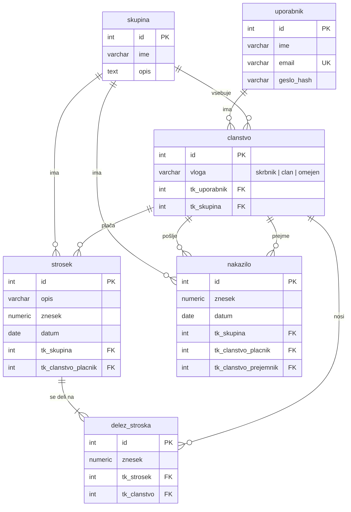

# 03 – Podatkovni model

## Entitete

**uporabnik** predstavlja osebo z uporabniškim računom. Hrani ime, e-poštni naslov, ki je enoličen, in zgoščeno geslo.

**skupina** je gospodinjstvo, na primer "Doma" ali "Stanovanje Maribor". Hrani ime in kratek opis.

**clanstvo** povezuje uporabnika s skupino in hrani njegovo vlogo v tej skupini ("skrbnik", "clan" ali "omejen"). Ker uporabnik lahko pripada več skupinam z različnimi vlogami, so pravice vezane na članstvo in ne na uporabnika. Na članstvo se sklicujejo tudi stroški, deleži in nakazila, s čimer je zagotovljeno, da v njih nastopajo samo člani te skupine.

**strosek** je posamezen izdatek v skupini. Hrani opis, znesek, datum in člana, ki ga je plačal.

**delez_stroska** hrani, koliko posameznega stroška nosi določen član. Deleži se izračunajo ob vnosu stroška, njihova vsota pa je vedno enaka znesku stroška. Član, ki stroška ne koristi, deleža nima.

**nakazilo** beleži plačilo med dvema članoma skupine za poravnavo dolga. Hrani plačnika, prejemnika, znesek in datum.

Stanje člana se ne shranjuje, ampak se izračuna iz obstoječih podatkov: vsota stroškov, ki jih je plačal, minus vsota njegovih deležev, plus nakazila, ki jih je poslal, minus nakazila, ki jih je prejel. Tako se stanje nikoli ne more razhajati s stroški in nakazili.

## Povezave

- Uporabnik ima lahko več članstev, vsako članstvo pa pripada natanko enemu uporabniku in eni skupini.
- Skupina ima več članstev, stroškov in nakazil.
- Strošek ima enega plačnika (članstvo) in več deležev.
- Delež povezuje en strošek z enim članstvom.
- Nakazilo ima natanko enega plačnika in enega prejemnika (obe sta članstvi iz iste skupine).

## E-R diagram

