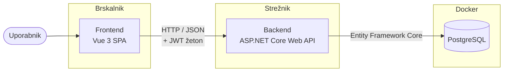

# 04 – Arhitektura in tehnološki sklad

## Arhitektura

### Glavni deli sistema

Delež je sestavljen iz treh delov. Frontend je enostranska spletna aplikacija, ki teče v brskalniku in prikazuje skupine, stroške, stanja in predlagana nakazila. Backend je REST API, ki skrbi za poslovno logiko, preverjanje pravic in dostop do podatkov. Podatkovna baza hrani uporabnike, skupine, članstva, stroške, deleže in nakazila.

Vsa domenska logika je v backendu. Tam se ob vnosu stroška izračunajo deleži, iz stroškov in nakazil se izračuna stanje vsakega člana itd. Frontend nato te izračune samo prikazuje.

### Komunikacija med deli sistema

Frontend z backendom komunicira prek HTTP z zahtevki in odgovori v obliki JSON. Vsak zahtevek, razen prijave in registracije, vsebuje JWT žeton. Backend z bazo komunicira prek ogrodja Entity Framework Core, ki preslika C# razrede v tabele in obratno.

### Podatkovna baza

Uporabljena je relacijska podatkovna baza PostgreSQL in se ustvari z migracijami Entity Framework Core.

### Avtentikacija in upravljanje uporabnikov

Uporabnik se registrira z imenom, e-poštnim naslovom in geslom. Geslo se pred shranjevanjem zgosti z algoritmom BCrypt. Ob prijavi backend preveri geslo in vrne JWT žeton, ki ga frontend hrani in pošilja z vsakim zahtevkom.

Avtorizacija poteka na ravni skupine. Ker so vloge vezane na članstvo, backend pri vsakem zahtevku, ki zadeva skupino, preveri, ali je uporabnik njen član in kakšno vlogo ima. Npr. brisanje tujega stroška je dovoljeno samo skrbniku, omejen član pa dobi samo stroške, v katerih ima delež.

### Lokalni zagon

PostgreSQL bo tekel v Docker zabojniku. Backend in frontend pa se bosta med razvojem zaganjala neposredno na računalniku, kar bo omogočilo hitro osveževanje ob spremembah kode.

### Diagram arhitekture

## Tehnološki sklad

**Frontend:** Vue 3 z orodjem Vite za razvoj in gradnjo, Vue Router za navigacijo med stranmi, Pinia za hranjenje stanja (prijavljen uporabnik, žeton), Axios za klice API-ja in Vuetify za osnovni izgled

**Backend:** C# in ASP.NET Core Web API na platformi .NET 10, Entity Framework Core s ponudnikom Npgsql za dostop do baze ter Swagger UI za pregled in testiranje API-ja.

**Podatkovna baza:** PostgreSQL 18.

**Avtentikacija:** JWT žetoni in BCrypt.Net za zgoščevanje gesel.

**Lokalni razvoj:** Docker in Docker Compose za bazo, Visual Studio Code, Node.js z npm za frontend, Git in GitHub za upravljanje izvorne kode.

**Drugo:** DataGrip 2026.2.6 za pregled podatkov v bazi.

## Arhitekturne odločitve

**Ločen frontend in backend.** Frontend in backend sta ločeni aplikaciji, povezani prek REST API-ja. To omogoča, da se frontend kasneje zamenja (npr. z Reactom) brez sprememb backenda, hkrati pa je API mogoče testirati neodvisno prek Swagger UI.

**ASP.NET Core za backend.** C# je jezik v katerem programiram že zelo dolgo, zato se lahko osredotočim na domensko logiko namesto na učenje novega jezika. ASP.NET Core je zrelo ogrodje z dobro podporo za REST API, avtentikacijo in delo z bazo.

**Vue za frontend.** Ker sem v razvijanju frontenda šibek, sem si v tem primeru izbral Vue, zato, ker ima položnejšo krivuljo učenja kot React ali Angular in je bližje klasičnemu HTML.

**PostgreSQL kot podatkovna baza.** Podatki so izrazito relacijski: stroški, deleži in nakazila so vezani na članstva, ta pa na uporabnike in skupine. Relacijska baza s tujimi ključi in omejitvami zagotavlja, da podatki ostanejo skladni, PostgreSQL pa je brezplačen in dobro podprt v Entity Framework Core.

**Lastna avtentikacija z JWT namesto ASP.NET Core Identity.** Identity ustvari vrsto lastnih tabel, ki se ne ujemajo s preprostim podatkovnim modelom aplikacije. Lastna tabela "uporabnik" z BCrypt zgoščenimi gesli in JWT žetoni je za potrebe projekta dovolj varna in bistveno preprostejša.

**Stanje se izračuna, ne shranjuje.** Stanje člana se ob vsakem zahtevku izračuna iz stroškov, deležev in nakazil. Pri velikosti gospodinjstva je to hitro, hkrati pa se stanje nikoli ne more razhajati z dejanskimi podatki.

**Docker samo za bazo.** V Dockerju teče samo PostgreSQL, ker ga je tako najlažje namestiti in ponastaviti. Backend in frontend tečeta neposredno, kar je med razvojem preprostejše za razhroščevanje.