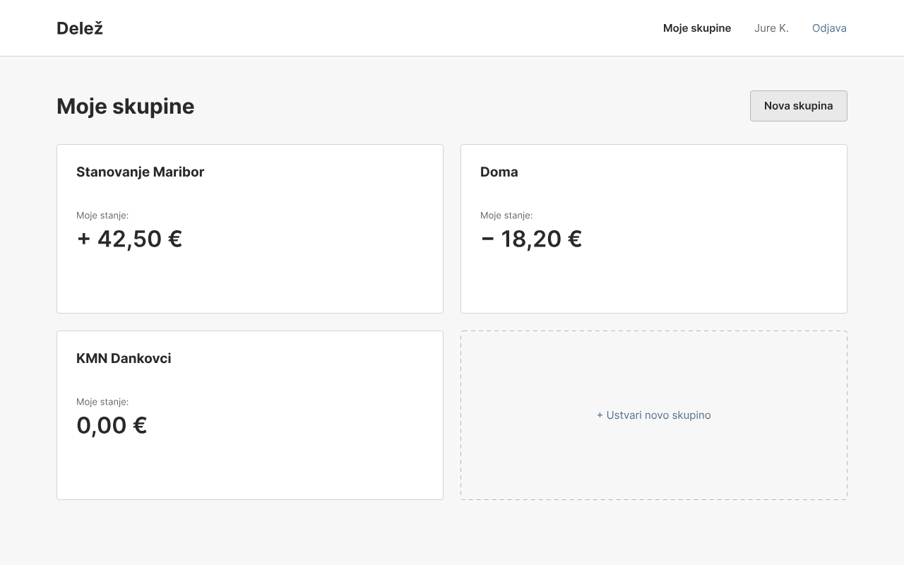
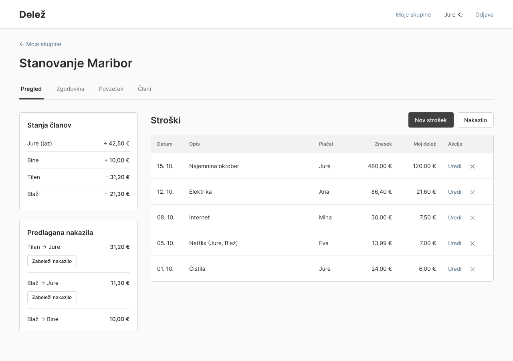
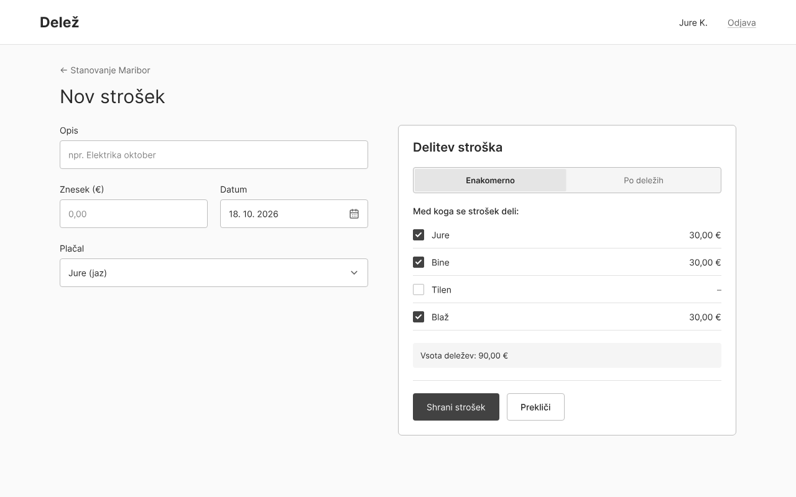

# 05 – Wireframes

## WF-01: Pregled skupin

Začetni zaslon po prijavi. Vsaka skupina je kartica z imenom in njegovim stanjem, ki je pozitivno, negativno ali poravnano. Gumb "Nova skupina" in prazna črtkana kartica odpreta ustvarjanje nove skupine.

## WF-02: Stran skupine

Glavni zaslon aplikacije, prikazan v pogledu skrbnika. Levo sta kartici s stanji vseh članov in s predlaganimi nakazili, pri katerih gumb "Zabeleži nakazilo" odpre beleženje nakazila. Desno je tabela stroškov z datumom, opisom, plačnikom, zneskom in mojim deležem ter gumbi "Nov strošek" in "Nakazilo". Akciji "Uredi" in "X" ima skrbnik pri vseh stroških, član pa samo pri svojih. Zavihki "Zgodovina", "Povzetek" in "Člani" vodijo na ostale preglede skupine.

## WF-03: Vnos stroška

Obrazec za nov strošek z opisom, zneskom, datumom in plačnikom. Na desni je izbira načina delitve ("Enakomerno" ali "Po deležih") s seznamom članov. Pri enakomerni delitvi aplikacija sproti izračuna delež vsakega izbranega člana. Član, ki stroška ne koristi, ni izbran in deleža nima.